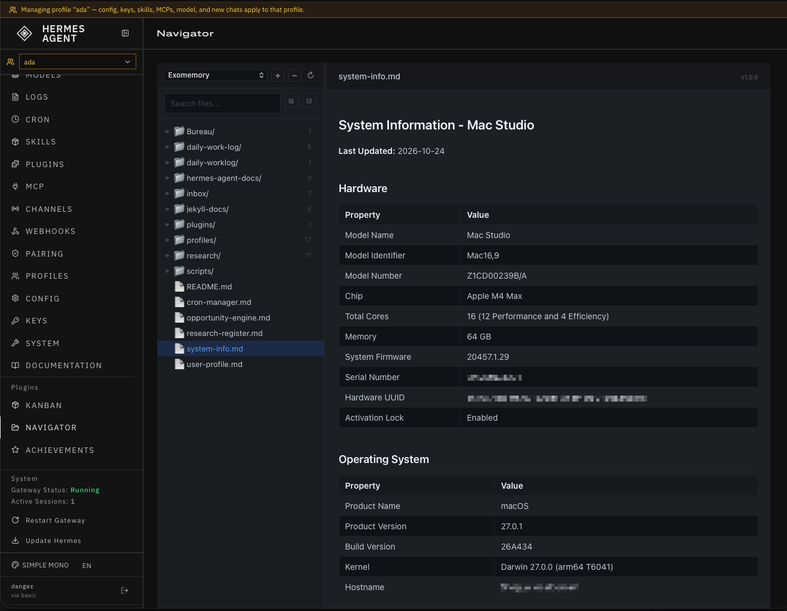

# hermes-plugin-navigator

A [Hermes Agent](https://hermes-agent.nousresearch.com) dashboard plugin that
browses Markdown files across any number of user-configured folder
locations — a single "Navigator" tab with a location switcher, instead of
one hardcoded plugin per folder.



## What it does

Adds a `Navigator` tab to the dashboard (after `Kanban`) with a file-tree
sidebar, search/filter, and a rendered-Markdown content pane. Unlike a
folder-specific browser, locations aren't baked into the plugin — you add,
switch between, and remove named folders from the UI itself.

## Install

```bash
git clone https://github.com/sylumer/hermes-plugin-navigator.git ~/.hermes/plugins/navigator
hermes plugins enable navigator
```

Then either restart the dashboard or hit `GET /api/dashboard/plugins/rescan`.

To uninstall: `rm -rf ~/.hermes/plugins/navigator` and rescan (this also
deletes its `locations.json`, so back that up first if you want to keep the
configured folder list).

## Using it

From the Navigator tab: click `+` in the sidebar header, give it a name and
a folder path (`~` is expanded), and save. Switch between configured
locations with the dropdown; click `−` to remove the currently selected one
(with an inline confirm, no browser `confirm()` dialog).

On first use, it seeds two example locations (`~/.hermes/exomemory` and
`~/.hermes/opportunities`) — edit or remove them from the UI once you've
added your own.

See [DEVELOPMENT.md](DEVELOPMENT.md) for the API, file layout, and how to
work on the plugin itself.

## Credits

Started from Hermes Agent's `exomemory-navigator` / `opportunities-navigator`
reference plugins — same file-tree-and-Markdown-viewer shape, generalized to
support more than one hardcoded folder.

## License

Navigator is [Coffeeware](https://raw.githubusercontent.com/sylumer/hermes-plugin-navigator/refs/heads/main/.github/LICENSE.txt) - you can use it for free, [buy me a coffee to say thanks](https://www.buymeacoffee.com/sylumer), and there are some attribution requirements should you want to modify and reshare it.

<a href="https://www.buymeacoffee.com/sylumer" target="_blank"></a>
